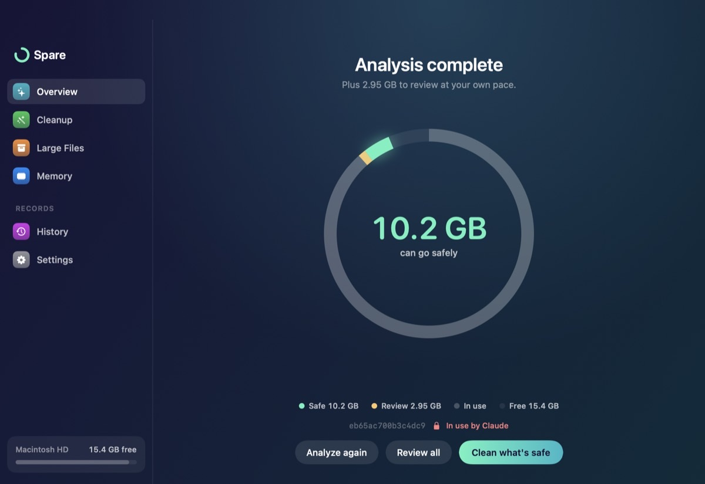
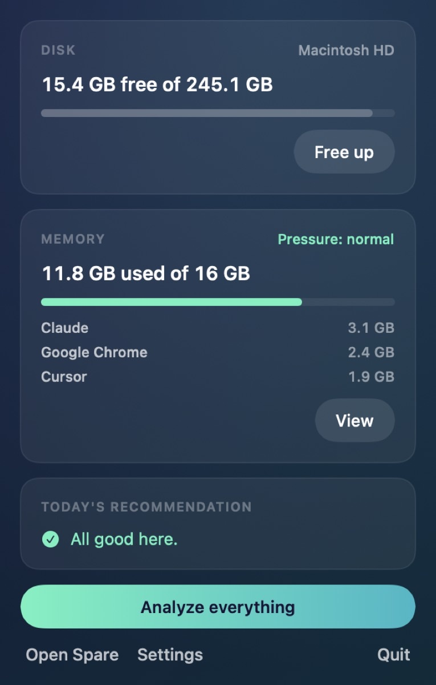
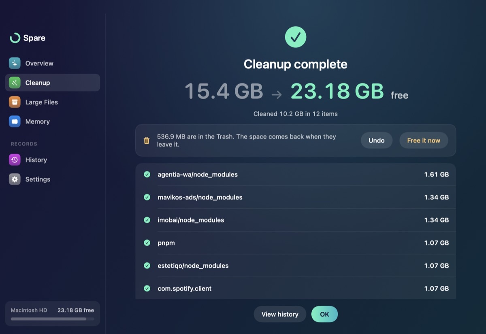
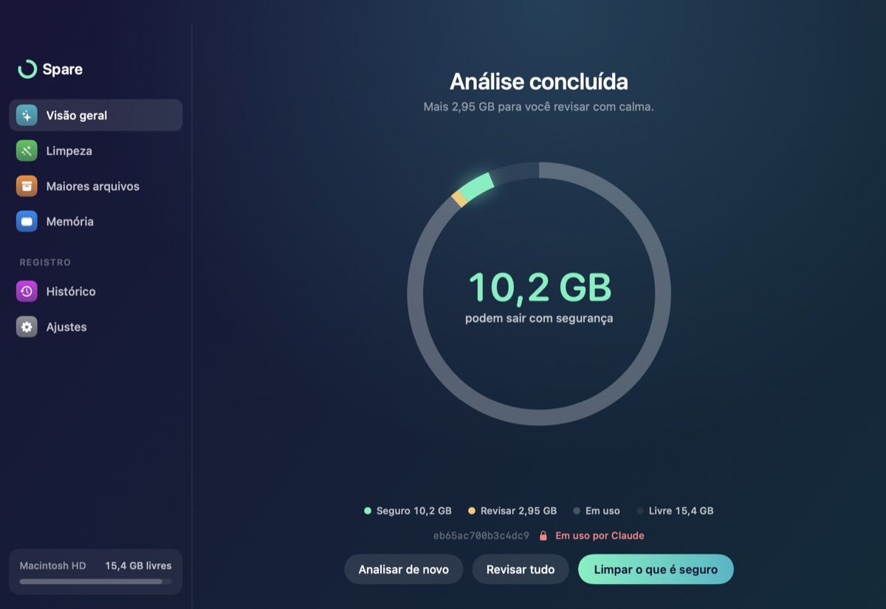
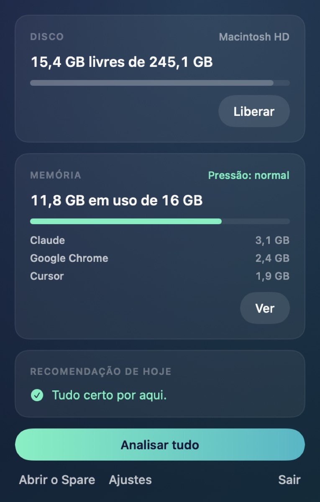
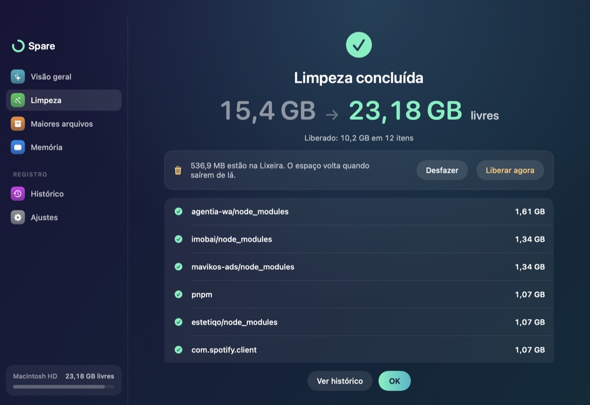

# Spare

Spare keeps your Mac's disk and memory in check, with a focus on developer and AI junk. Free, open source, menu bar app plus CLI.

**Status:** v0.1.0, first release candidate. Progress: [`docs/planta/STATUS.md`](docs/planta/STATUS.md). QA report: [`docs/qa/2026-10-v0.1.0.md`](docs/qa/2026-10-v0.1.0.md).



| Menu bar panel | Cleanup result |
|---|---|
|  |  |

More screens (Portuguese): [overview](docs/img/pt-overview.jpg), [cleaning](docs/img/pt-cleaning.jpg), [confirmation](docs/img/pt-confirm.jpg), [history](docs/img/pt-history.jpg), [largest files](docs/img/pt-large-files.jpg), [memory](docs/img/pt-memory.jpg), [settings](docs/img/pt-settings.jpg). English: [memory](docs/img/en-memory.jpg), [largest files](docs/img/en-large-files.jpg), [settings](docs/img/en-settings.jpg).

## Why

People who code and use AI on a Mac pile up tens of GB of invisible junk: `npm`, `uv` and `pnpm` caches, `node_modules` of idle projects, downloaded AI models and old runtimes. Generic cleaners (for example CleanMyMac) do not see most of it. Real evidence from the author's Mac on 2026-10-22: disk at 96% (9.2 GB free); CleanMyMac found 4.4 GB of junk, while about 35 GB was recoverable developer and AI junk.

## Features (MVP)

1. Menu bar icon with free space in GB and a panel with Disk, Memory and "Today's recommendation" cards.
2. Alerts when free space drops below your limit (default 15 GB) and when memory pressure is high.
3. "Analyze everything": one scan of disk and memory, with visible progress and a Stop button.
4. Cleanup by category, with total size, a safety badge, and Review and Clean buttons.
5. Review screen: every item with a checkbox, size, badge and explanation.
6. Safe execution: deletes only what regenerates itself, moves the rest to the Trash or runs the tool's official cleanup command, and skips items in use.
7. Result and Undo: free space before and after, a record per category, Undo (restores from the Trash) and "Free now" (empties only what Spare put in the Trash).
8. History of previous cleanups.
9. Largest files: pick a folder, list the 20 largest files above 500 MB, Show in Finder, Move to Trash.
10. Memory: pressure and the 15 heaviest processes, with a Quit button (your own processes only).
11. Settings: alert limit, project folders, idle days, open at login.
12. English and Brazilian Portuguese, following the system language.
13. `spare` CLI with the same engine and JSON output.

## Safety

- Closed catalog: Spare only touches paths listed in its rule catalog or in your configured project folders.
- Symbolic links are never followed outside a rule's path; sizes count only real content.
- A protected list is never a target: nothing outside your home folder, and never Documents, Desktop, Pictures, Movies, Music, `~/Library` root, `.ssh`, `.gnupg`, `.aws`, `.kube`, Keychains or iCloud Drive.
- Items in use are skipped: an open app, a process whose command line uses the path, or a running tool.
- Project folders (`node_modules`, `.venv`, `.next`, `target`) are only listed when the project is idle and has its manifest file.
- Delete only what regenerates; everything else goes to the Trash with a recorded location, so Undo works.
- Emptying the system Trash is the only permanent removal and needs explicit confirmation.
- Quitting a process: only your own, never PID 1 or system processes, never Spare itself, and never `SIGKILL`.

## Install

Requires macOS 14 or later. The v0.1.0 build is for Apple Silicon (arm64).

1. Download `Spare-0.1.0.dmg` (and `Spare-0.1.0.dmg.sha256`) from the [Releases page](https://github.com/rafaeljorge-ai/spare/releases). Optional check: in the download folder, run `shasum -a 256 -c Spare-0.1.0.dmg.sha256`; it must print `OK`.
2. Open the `.dmg` and drag Spare onto the Applications shortcut.
3. Open Spare from Applications. macOS blocks it, because the app is not notarized (that needs a paid Apple developer account). Click **Done** (do not move it to the Bin).
4. Open **System Settings > Privacy & Security**, scroll down to the message that says Spare was blocked, click **Open Anyway** and confirm with your password or Touch ID.
5. Open Spare again and click **Open**. This is needed only once.
6. Spare lives in the menu bar (the ring and your free GB). The Dock icon appears only while the main window is open.

## What it cleans, and what it never touches

Cleans (only what regenerates, or what goes to the Trash with Undo): developer caches (`npm`, `pnpm`, `yarn`, `uv`, `pip`, Cargo, Homebrew downloads, Xcode DerivedData, pre-commit, Playwright), AI model caches (Hugging Face, Whisper, Ollama, LM Studio), app caches and logs, old installers in Downloads, `node_modules`, `.venv`, `.next` and `target` of projects idle for 30 days, and the Trash (only on explicit confirmation).

Never touches: anything outside your home folder, Documents, Desktop, Pictures, Movies, Music, the `~/Library` root, `.ssh`, `.gnupg`, `.aws`, `.kube`, Keychains, Mail, Messages and iCloud Drive; items in use; projects with recent activity.

## Visible safety

Every item shows a Safe or Review badge and the reason. Nothing runs before a confirmation that separates "deleted for good" from "goes to the Trash". Items in use are shown with the app that holds them and cannot be selected. A result screen shows the free space before and after, with Undo. Every cleanup is recorded in History.

## Limitations

- Not notarized: the "Open Anyway" step above is required. Notarization costs USD 99 per year and is planned once the project has users.
- Apple Silicon only in v0.1.0 (the Command Line Tools build here is arm64).
- Memory numbers are approximate: they are built from public APIs, and shared memory is counted in every process that uses it.
- The cleanup record is saved when the cleanup ends; a crash in the middle loses the Undo for the items already moved (planned for v0.2).
- Dark theme only. No Homebrew tap yet.

## Build from source

Requires macOS 14+ and Swift 6 (Command Line Tools are enough, Xcode is optional).

```
swift build
scripts/check.sh       # full local gate (runs the tests)
scripts/build-app.sh   # builds dist/Spare.app (and its icon)
scripts/build-dmg.sh   # builds dist/Spare-<version>.dmg and its .sha256
swift build -c release --product spare   # the CLI, then copy .build/release/spare into your PATH
```

## CLI usage

```
spare status [--json]      Free disk space and memory
spare scan [--json] [--category ID]   Preview what can be freed (changes nothing)
spare rules                List rule IDs
spare clean --rule ID [--rule ID] [--yes] [--dry-run] [--json]
                           Clean the items of these rules. Without --yes it only previews;
                           --dry-run always previews. Items in use are never cleaned.
spare undo [RECORD_ID] [--dry-run]
                           Restore trashed items of the last (or given) cleanup; an item whose
                           original path is taken stays in the Trash and the reason is printed
spare purge [RECORD_ID] [--yes] [--dry-run]
                           Permanently delete the items Spare itself moved to the Trash (the rest of
                           the Trash is never touched). Without --yes it only previews.
spare history [--json]     Past cleanups
spare large [PATH] [--min-mb 500] [--limit 20] [--json]   Biggest files under PATH
spare large --trash FILE [--yes] [--dry-run]   Move chosen files to the Trash, with Undo
spare memory [--json]      Memory pressure and top consumers (approximate: built from public APIs,
                           shared memory is counted in every process that uses it)
spare help                 Show this help
```

Safe first run: `spare scan`, then `spare clean --rule dev.npx` (preview only), then add `--yes`. Cleanups are
saved in `~/Library/Application Support/Spare/history.json` (folder `0700`, file `0600`).

## Project docs

- [PRD](docs/planta/01-PRD.md)
- [TRD](docs/planta/02-TRD.md)
- [Screens and flows](docs/planta/03-TELAS-E-FLUXOS.md)
- [Data and permissions](docs/planta/04-DADOS-E-PERMISSOES.md)
- [Operations and release](docs/planta/05-OPERACAO-E-RELEASE.md)
- [Status](docs/planta/STATUS.md)
- [Design system](.interface-design/system.md) and the visual prototype (`Prototype/run.sh`)
- [Implementation plan](docs/superpowers/plans/2026-10-22-spare-mvp/00-INDEX.md)

## License

MIT. See [LICENSE](LICENSE).

## Português

Spare mantém o disco e a memória do seu Mac em ordem, com foco no lixo de desenvolvimento e de IA. Gratuito, código aberto, app de barra de menus mais CLI.

**Status:** v0.1.0, primeira versão candidata. Andamento: [`docs/planta/STATUS.md`](docs/planta/STATUS.md). Relatório de QA: [`docs/qa/2026-10-v0.1.0.md`](docs/qa/2026-10-v0.1.0.md).



| Painel da barra de menus | Resultado da limpeza |
|---|---|
|  |  |

### Por quê

Quem programa e usa IA no Mac acumula dezenas de GB de lixo invisível: caches de `npm`, `uv` e `pnpm`, `node_modules` de projetos parados, modelos de IA baixados e runtimes antigos. Limpadores genéricos (por exemplo, o CleanMyMac) não enxergam a maior parte disso. Evidência real do Mac do autor em 2026-10-22: disco a 96% (9,2 GB livres); o CleanMyMac encontrou 4,4 GB de lixo, enquanto cerca de 35 GB eram lixo de desenvolvimento e IA recuperável.

### Funcionalidades (MVP)

1. Ícone na barra de menus com o espaço livre em GB e um painel com os cartões Disco, Memória e "Recomendação de hoje".
2. Alertas quando o espaço livre cai abaixo do seu limite (padrão 15 GB) e quando a pressão de memória fica alta.
3. "Analisar tudo": uma varredura de disco e memória, com progresso visível e botão Parar.
4. Limpeza por categorias, com tamanho total, selo de segurança e botões Revisar e Limpar.
5. Revisão: cada item com caixa de seleção, tamanho, selo e explicação.
6. Execução segura: apaga só o que se regenera, move o resto para a Lixeira ou roda o comando oficial da ferramenta, e pula itens em uso.
7. Resultado e Desfazer: espaço livre antes e depois, registro por categoria, Desfazer (restaura da Lixeira) e "Liberar agora" (apaga só o que o Spare mandou para a Lixeira).
8. Histórico das limpezas anteriores.
9. Maiores arquivos: escolha uma pasta, veja os 20 maiores acima de 500 MB, Mostrar no Finder, Mover para a Lixeira.
10. Memória: pressão e os 15 processos mais pesados, com botão Encerrar (só processos seus).
11. Ajustes: limite do alerta, pastas de projetos, dias de inatividade, abrir ao iniciar sessão.
12. Português (Brasil) e inglês, seguindo o idioma do sistema.
13. CLI `spare` com o mesmo motor e saída JSON.

### Segurança

- Catálogo fechado: o Spare só mexe em caminhos do seu catálogo de regras ou nas pastas de projetos que você configurou.
- Links simbólicos nunca são seguidos para fora do caminho da regra; o tamanho conta só o conteúdo real.
- Uma lista de proteção nunca é alvo: nada fora da sua pasta pessoal, e nunca Documentos, Mesa, Imagens, Filmes, Música, a raiz de `~/Library`, `.ssh`, `.gnupg`, `.aws`, `.kube`, Keychains ou iCloud Drive.
- Itens em uso são pulados: app aberto, processo cuja linha de comando usa o caminho, ou ferramenta em execução.
- Pastas de projeto (`node_modules`, `.venv`, `.next`, `target`) só aparecem quando o projeto está parado e tem o arquivo de manifesto.
- Apagar só o que se regenera; o resto vai para a Lixeira com o local registrado, para o Desfazer funcionar.
- Esvaziar a Lixeira do sistema é a única remoção definitiva e exige confirmação explícita.
- Encerrar processo: só os seus, nunca o PID 1 nem processos do sistema, nunca o próprio Spare, e nunca `SIGKILL`.

### Instalação

Requer macOS 14 ou superior. A versão 0.1.0 é para Apple Silicon (arm64).

1. Baixe `Spare-0.1.0.dmg` (e `Spare-0.1.0.dmg.sha256`) na [página de Releases](https://github.com/rafaeljorge-ai/spare/releases). Conferência opcional: na pasta do download, rode `shasum -a 256 -c Spare-0.1.0.dmg.sha256`; deve mostrar `OK`.
2. Abra o `.dmg` e arraste o Spare para o atalho de Aplicativos.
3. Abra o Spare em Aplicativos. O macOS bloqueia, porque o app não é notarizado (isso exige uma conta Apple paga). Clique em **Concluído** (não mova para o Lixo).
4. Abra **Ajustes do Sistema > Privacidade e Segurança**, role até a mensagem de que o Spare foi bloqueado, clique em **Abrir Mesmo Assim** e confirme com a senha ou o Touch ID.
5. Abra o Spare de novo e clique em **Abrir**. Só é preciso uma vez.
6. O Spare fica na barra de menus (o anel e seus GB livres). O ícone no Dock só aparece com a janela principal aberta.

### O que limpa e o que nunca toca

Limpa (só o que se regenera, ou o que vai para a Lixeira com Desfazer): caches de desenvolvimento (`npm`, `pnpm`, `yarn`, `uv`, `pip`, Cargo, downloads do Homebrew, DerivedData do Xcode, pre-commit, Playwright), caches de modelos de IA (Hugging Face, Whisper, Ollama, LM Studio), caches e logs de apps, instaladores antigos em Downloads, `node_modules`, `.venv`, `.next` e `target` de projetos parados há 30 dias, e a Lixeira (só com confirmação explícita).

Nunca toca: nada fora da sua pasta pessoal, Documentos, Mesa, Imagens, Filmes, Música, a raiz de `~/Library`, `.ssh`, `.gnupg`, `.aws`, `.kube`, Keychains, Mail, Mensagens e iCloud Drive; itens em uso; projetos com atividade recente.

### Segurança visível

Cada item mostra o selo Seguro ou Revisar e o motivo. Nada roda antes de uma confirmação que separa "apagado de vez" de "vai para a Lixeira". Itens em uso aparecem com o app que os segura e não podem ser marcados. O resultado mostra o espaço livre antes e depois, com Desfazer. Toda limpeza fica registrada no Histórico.

### Limitações

- Sem notarização: o passo "Abrir Mesmo Assim" acima é obrigatório. A notarização custa USD 99 por ano e fica para quando o projeto tiver usuários.
- Só Apple Silicon na v0.1.0 (o build com as Command Line Tools aqui é arm64).
- Os números de memória são aproximados: vêm de APIs públicas, e a memória compartilhada é contada em cada processo que a usa.
- O registro da limpeza é salvo ao final; uma queda no meio perde o Desfazer dos itens já movidos (previsto para a v0.2).
- Só tema escuro. Ainda sem tap do Homebrew.

### Compilar do código-fonte

Requer macOS 14+ e Swift 6 (as Command Line Tools bastam, o Xcode é opcional).

```
swift build
scripts/check.sh       # gate local completo (roda os testes)
scripts/build-app.sh   # gera dist/Spare.app (e o ícone)
scripts/build-dmg.sh   # gera dist/Spare-<versão>.dmg e o .sha256
swift build -c release --product spare   # a CLI; depois copie .build/release/spare para o seu PATH
```

### Uso da CLI

```
spare status [--json]      Espaço livre em disco
spare scan [--json] [--category ID]   Mostra o que dá para liberar (não altera nada)
spare rules                Lista os IDs das regras
spare clean --rule ID [--rule ID] [--yes] [--dry-run] [--json]
                           Limpa os itens dessas regras. Sem --yes só mostra o que faria;
                           --dry-run sempre só mostra. Itens em uso nunca são limpos.
spare undo [ID_DA_LIMPEZA] [--dry-run]
                           Devolve os itens da última limpeza (ou da informada) ao lugar original;
                           se o lugar original estiver ocupado, o item fica na Lixeira e o motivo é mostrado
spare purge [ID_DA_LIMPEZA] [--yes] [--dry-run]
                           Apaga para sempre só os itens que o próprio Spare mandou para a Lixeira
                           (o resto da Lixeira nunca é tocado). Sem --yes só mostra o que faria.
spare history [--json]     Limpezas anteriores
spare large [CAMINHO] [--min-mb 500] [--limit 20] [--json]   Maiores arquivos de uma pasta
spare large --trash ARQUIVO [--yes] [--dry-run]   Manda arquivos para a Lixeira, com Desfazer
spare memory [--json]      Pressão de memória e maiores consumidores (aproximado: APIs públicas,
                           memória compartilhada é contada em cada processo que a usa)
spare help                 Mostra a ajuda
```

Primeiro uso seguro: `spare scan`, depois `spare clean --rule dev.npx` (só prévia), e então acrescente `--yes`.
O histórico fica em `~/Library/Application Support/Spare/history.json` (pasta `0700`, arquivo `0600`).

### Documentação do projeto

Veja a lista na seção "Project docs" acima.

### Licença

MIT. Veja [LICENSE](LICENSE).
